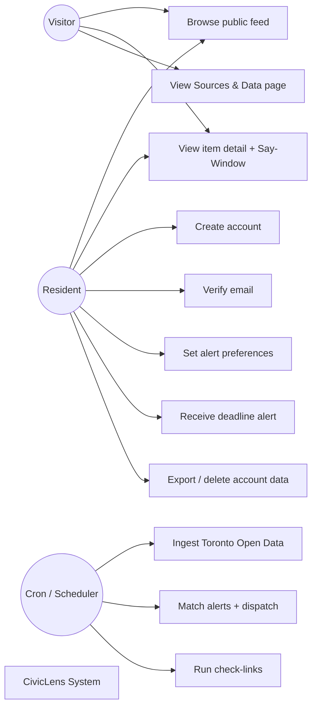
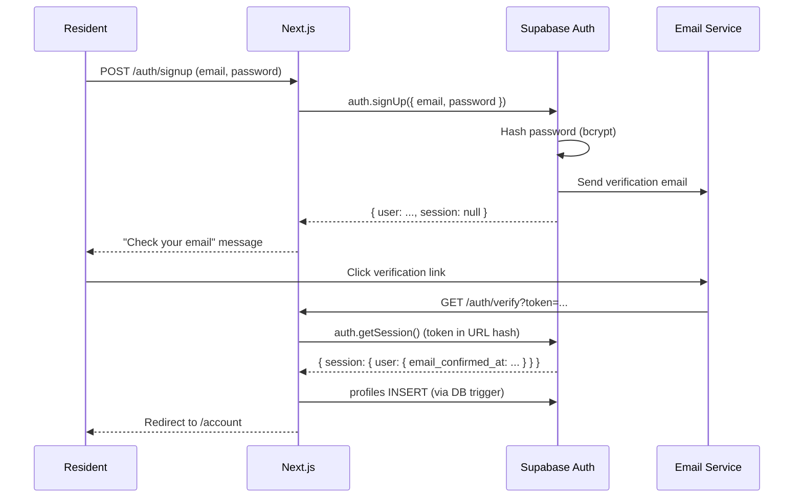
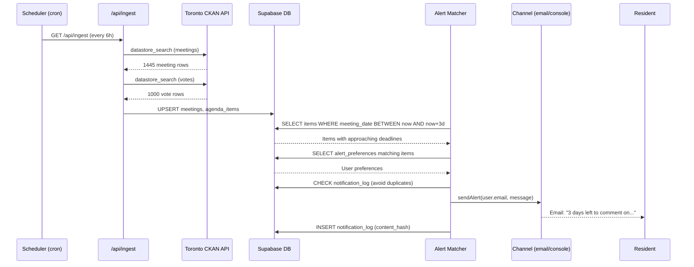
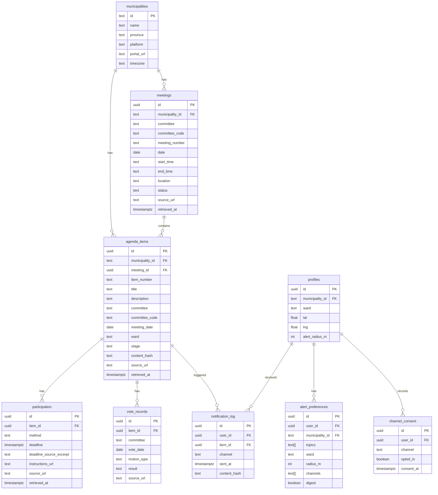

# UML Diagrams — CivicLens

> [Documentation index](../README.md)

All diagrams use Mermaid syntax. Render at https://mermaid.live or in VS Code
with the Mermaid Preview extension.

---

## 1. Use Case Diagram



---

## 2. Architecture / Component Diagram

```mermaid
graph TB
    subgraph Browser
        UI[Next.js React UI]
        UI -->|fetch| FeedAPI[/api route]
    end

    subgraph Next.js App Server
        Feed[/feed page]
        Item[/item/[id] page]
        Auth[/auth/* pages]
        Account[/account page]
        Ingest[/api/ingest]
        Proxy[proxy.ts - session refresh]
    end

    subgraph Adapters
        TOAdapter[toronto-opendata.ts]
    end

    subgraph External APIs
        CKAN[Toronto CKAN API]
        TMMIS[TMMIS secure.toronto.ca - 403 blocked]
    end

    subgraph Supabase
        SupaAuth[Supabase Auth]
        SupaDB[(Postgres + RLS)]
    end

    subgraph Alert Channels
        Console[Console - dev]
        Resend[Resend email]
    end

    Feed --> TOAdapter
    Item --> TOAdapter
    Ingest --> TOAdapter
    TOAdapter --> CKAN
    TOAdapter -.->|source links point here| TMMIS

    Auth --> SupaAuth
    Account --> SupaDB
    Proxy --> SupaAuth

    Ingest --> SupaDB
    AlertJob[Alert Job - planned] --> SupaDB
    AlertJob --> Console
    AlertJob --> Resend
```

---

## 3. Sequence Diagram — User Signup Flow



---

## 4. Sequence Diagram — Alert Flow



---

## 5. ER Diagram


