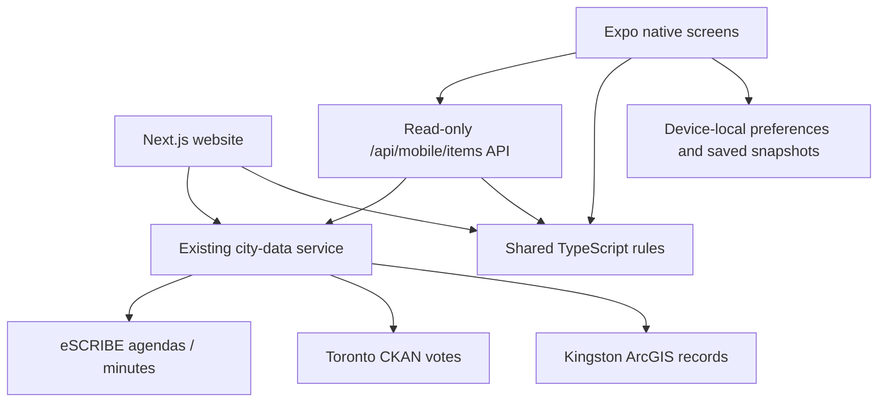

# Mobile architecture and handoff

> [Documentation index](../README.md)

## Repository before / after

```text
Before                        After
src/ (Next.js website)        src/ (website stays at root)
public/                       src/app/api/mobile/items/ (read-only JSON)
tests/                        apps/mobile/ (Expo native UI + assets)
package.json                  packages/shared/ (contract + pure-rule exports)
package-lock.json             docs/architecture/mobile-architecture.md
                              docs/quality/mobile-testing.md
                              tests/mobile.test.mjs
                              package.json + one npm workspace lockfile
```

Root npm scripts and deployment remain the website's commands. Only mobile TS files are excluded from the Next.js compiler; the mobile workspace runs its own compiler. Expo's automatic monorepo resolution is used without custom Metro resolver overrides. No second repository, admin app or source database was created.



## Files and responsibilities

| Files | Implementation |
| --- | --- |
| `apps/mobile/app/_layout.tsx`, `(tabs)/_layout.tsx` | Native Stack/Tabs navigation, system theme, safe areas, providers |
| `(tabs)/index.tsx` | Skippable onboarding entry, live feed, search/topic/time/body selection, finite request/error/retry and empty states |
| `src/preferences.tsx` | City/topics/time onboarding and editable Settings controls |
| `app/item/[id].tsx` | Live detail refresh with cached fallback; description/rationale limitations, impact excerpts, stage, votes, timeline, source links and participation state |
| `(tabs)/saved.tsx`, `src/store.tsx` | Local AsyncStorage snapshots/preferences, save/remove/clear and explicit persistence errors |
| `src/civi.tsx`, `(tabs)/civi.tsx` | Floating launcher, accessible modal choices, contextual deterministic guidance and source actions |
| `src/ui.tsx`, `src/item-card.tsx` | Native touch controls, cards, gavel icons, text scaling, themed contrast and safe external linking |
| `src/api.ts` | Public base URL, cancellation, 60-second timeout, response validation and recent-record cache |
| `packages/shared/index.ts` | Reexports actual website types, registry and pure functions instead of copying policy logic |
| `packages/shared/mobile.ts` | Versioned boundary validation, preferences parser, filter and Civi helpers, coverage disclosure |
| `src/app/api/mobile/items/route.ts` | Public city GET; same existing adapter data, removes redundant raw coordinates/address fields |
| `src/app/api/mobile/items/[itemNumber]/route.ts` | Public item GET; bounded ID, 404/503 responses |
| `tests/mobile.test.mjs` | Contract, unsafe source, preferences round-trip, combined filtering and guide uncertainty regressions |

## API and trust

`GET /api/mobile/items?city=ottawa` returns `{version:1, city, items, coverage}`. `GET /api/mobile/items/ITEM_NUMBER` returns `{version:1, items:[item]}`. Invalid cities return 400; missing current items return 404; source failures return 503 with a recoverable message. These routes are public and read-only, contain no account data and send CORS `*` without credentials. No privileged endpoint is exposed to the app.

Every accepted item must have an official HTTPS source URL, retrieval timestamp and supported municipality. Native linking rejects non-HTTPS and credential-bearing URLs. API failure never produces fabricated demo records. Coverage is explicitly a limited subset: existing adapters can skip unavailable meetings, and keyword matches can miss relevant items.

Participation uses the website's explicit evidence rule, not meeting dates. Current adapters do not populate verified windows; showing unknown is intentional. Source dates and retrieval timestamps are different; saved records disclose their snapshot nature. Meeting dates use the existing date-only formatting to avoid shifting the calendar day across time zones. Published deadline timestamps, if present, show the device's local date/time and zone.

Descriptions and vote statements remain official-source text or the website's deterministic transformations. Personal impacts, rationale, construction approval, work start and completion are not inferred. Civi is not an AI service and cannot submit comments.

## Dependencies and isolation

Installed compatibility set verified against Expo SDK 58's bundled module map:

| Package | Installed version |
| --- | --- |
| Expo | 58.0.25 |
| Expo Router | 58.0.31 |
| React / React DOM | 19.3.0 (same as website) |
| React Native | 0.88.1 |
| React Native Web | 0.21.4 |
| React Native Screens | 4.30.1 |
| Safe Area Context | 5.11.1 |
| AsyncStorage | 2.2.0 |
| Expo Constants / Linking / Status Bar | 58.0.16 / 58.0.17 / 58.0.5 |
| Expo vector icons | 15.1.1 |
| Mobile TypeScript | 6.0.3 compatible line; exact installed version in lockfile |

The website stays on Next.js 16.4.6 and its existing TypeScript 5 compiler. Mobile requires Node accepted by Expo/RN (use Node 24.3+ LTS; tested 24.22.3). One npm install resolves both workspaces. No dependency versions were force-upgraded to address unrelated advisories.

Official setup references: [Expo monorepos](https://docs.expo.dev/guides/monorepos/), [Router installation](https://docs.expo.dev/router/installation/). Assets: existing CivicLens logo and user-supplied Civi; MaterialCommunityIcons through Expo vector icons. Existing municipal sources retain their attribution and licences; [website sources](/sources) contains per-city coverage.

## Feature status and remaining work

“Partial” below means code/bundle or service verification exists, but device/UI verification is incomplete; it does not mean a mock screen substitutes for live data.

| Priority | Feature | Status |
| --- | --- | --- |
| P0 | Same-source public API and provenance | Working in live HTTP tests |
| P0 | Skippable onboarding/preferences | Partial — implemented, parsing tested; device persistence UI pending |
| P0 | Discover/filter/detail resident journey | Partial — live data + rules + native bundles checked; browser/device interaction unverified |
| P0 | Verified/unknown/closed input semantics | Working shared-rule tests; live verified-open examples unavailable |
| P0 | Floating/contextual Civi | Partial — deterministic helper tests and bundles pass; native accessibility/modal interaction pending |
| P1 | Saved snapshots | Partial — AsyncStorage wired; actual save/reload interaction pending |
| P1 | Important dates | Working pure formatting; device-local display needs confirmation; no calendar writes |
| P1 | Location relevance | City implemented; ward filtering/device location not started |
| P1 | Notifications | Not started; explicitly unavailable, saved-item snapshots instead |

Highest-impact next steps:

1. Run the real device walkthrough with phone LAN connectivity; test 320/393 px-equivalent widths, tablet, font scaling, VoiceOver/TalkBack, modal focus and local save/reload/offline behavior.
2. Connect a deployed HTTPS API for reliable off-LAN testing and verify empty/timeout/retry states under real network conditions.
3. Record a 2–3 minute demo showing a checked official record, uncertainty and source navigation; finish the one-page Municipal Readiness Report. No store submission is needed for this MVP.

No commits or pushes were made. Team members can review the new `apps/mobile`, `packages/shared`, API and documentation paths as one isolated change; the website was not relocated or redesigned. The [Civic Hack criteria](https://fciprojects.ca/hackathons/2026-civic-hack/) favor reliable demonstrated functionality and understandable evidence. Passing compilation does not establish rubric compliance or device usability.
